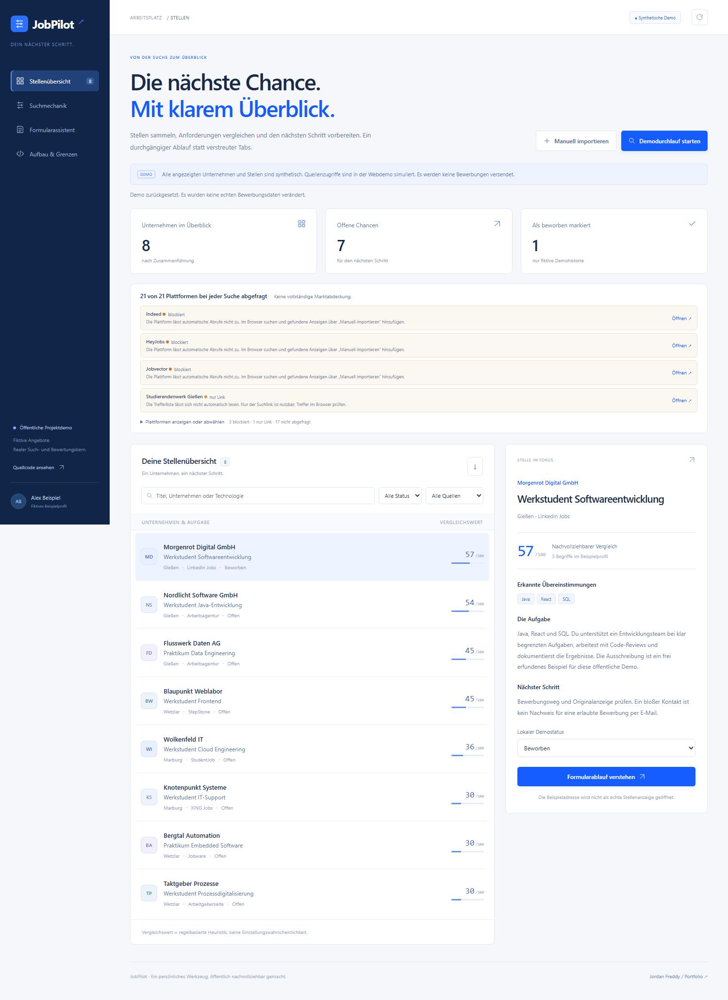

# JobPilot

**Stellen suchen, Anforderungen verstehen und den nächsten Schritt vorbereiten.**

[Interaktive Demo](https://jorxas.github.io/JobPilot/) · [Portfolio von Jordan Freddy](https://jorxas.github.io/Portfolio/)

JobPilot ist aus einem tatsächlich verwendeten persönlichen Werkzeug zur Jobsuche entstanden. Diese öffentliche Fassung übernimmt ausgewählte Such-, Bewertungs- und Formularmodule, ergänzt eine eigenständige deutsche Oberfläche und verwendet ausschließlich synthetische Beispieldaten. Das persönliche Original und seine Bewerbungsdaten bleiben privat. Die zusätzliche öffentliche Fassung wurde mit KI-Unterstützung entwickelt und geprüft.



## Was sich ausprobieren lässt

- **Stellenübersicht:** Angebote nach Titel, Unternehmen, Technologie, Quelle und Status filtern; eine Firma pro sichtbarer Option; jede Stelle nennt ihre Plattform; Originaldatensätze bleiben erhalten.
- **21 Plattformen:** Eine Zeile fasst zusammen, wie viele Jobbörsen bei jeder Suche gefragt werden. Hervorgehoben sind nur Plattformen, die den Browser brauchen (blockiert, nur Link, Abruf fehlgeschlagen). Jede Plattform lässt sich mit einem Klick ab- und wieder anwählen.
- **Nachvollziehbarer Vergleich:** Profilbegriffe, belegte Kenntnisse und Vertragsart bilden einen regelbasierten Wert. Der Wert ist keine Einstellungswahrscheinlichkeit und sagt keine berufliche Beherrschung einer Technologie aus.
- **Suchmechanik:** Ein Suchstart besteht aus fünf Durchläufen. Jede gewählte Plattform erhält je Durchlauf genau eine Anfrage, insgesamt fünf verschiedene Begriffe. Eigene Suchbegriffe kommen zuerst; fehlen Begriffe, ergänzen 25 IT-Themenfamilien mit Varianten für Werkstudentenstellen, Praktika und studentische Mitarbeit. Fehlende Profilkenntnisse entfernen keine Themenfamilie aus der Suche.
- **Nur Informatik:** Übernommen werden studentische Stellen mit IT-Bezug im Titel (einschließlich Content- und Redaktionsstellen, die oft die Pflege von Websites meinen). Senior-, Ausbildungs- und fachfremde Stellen werden verworfen.
- **Dubletten und Historie:** Gleichartige Angebote unterschiedlicher Quellen zusammenführen. Beworbene oder archivierte Unternehmen bleiben in der Historie; eine neue Suche setzt deren Entscheidungen nicht zurück.
- **Manueller Import und Export:** Eine Anzeige ohne automatischen Abruf aufnehmen; den eigenen lokalen Demostand als JSON herunterladen.
- **Formularassistent:** Der echte gemeinsame Feldmotor erkennt bekannte Felder, lässt offene Fragen sichtbar, verwendet ausdrückliche Antworten erneut und erhält vorhandene Eingaben. Ein Übungsformular zeigt den Ablauf ohne Arbeitgeberkontakt.

Die Browser-Demo simuliert Plattformzustände und benutzt erfundene Unternehmen. Bewertung, Spurplan, Gruppierung und Formularerkennung laufen tatsächlich. Sie besitzt kein gehostetes Suchbackend, fragt keine Jobbörse ab und versendet keine E-Mails. Links zu Suchportalen werden erst durch den Besucher geöffnet.

## Lokal starten

Node.js ab 22.12 und npm werden benötigt.

```sh
git clone https://github.com/Jorxas/JobPilot.git
cd JobPilot
npm ci
npm run dev
```

Öffnen: `http://127.0.0.1:3037/`. Die Oberfläche beginnt mit synthetischen Daten. Browseränderungen bleiben im lokalen Browserspeicher. Der optionale Server speichert seinen eigenen Arbeitsstand unter `daten/zustand.json`, einem ignorierten Laufzeitordner. `PORT` und `JOBPILOT_DATEN` können Port bzw. Datenverzeichnis ändern. Es werden keine Zugangsdaten oder persönlichen Profile mitgeliefert.

## Echte Stellensuche auf dem eigenen PC

Der lokale Server fragt dieselben 21 Plattformen wie das persönliche Original ab: Arbeitsagentur, LinkedIn Jobs, Indeed, StepStone, Stellenanzeigen.de, meinestadt.de, XING Jobs, HeyJobs, Jobware, Workwise, JobTeaser, Stellenwerk, StudentJob, Jobmensa, Absolventa, get in IT, Jobvector, UNICUM Karrierezentrum, Jobs in Mittelhessen, THM Jobportal und Studierendenwerk Gießen. Dazu kommen optional konfigurierte **Arbeitgeberseiten**. Live-Zugriffe sind standardmäßig aus und erfordern eine ausdrückliche Aktivierung:

```powershell
npm run build
$env:JOBPILOT_LIVE = '1'
npm start
```

Unter macOS oder Linux entsprechend `JOBPILOT_LIVE=1 npm start`. Anschließend unter **Aufbau & Grenzen** den lokalen Live-Modus wählen. Unter **Suchmechanik** Suchbegriffe, Ort und Umkreis eintragen, in der Stellenübersicht bei Bedarf Plattformen abwählen und **Live-Suche starten** klicken.

So läuft ein Suchstart ab, wie im Original:

- **Fünf Durchläufe, eine Anfrage je Plattform und Durchlauf.** Der Spurplan verteilt die Suchbegriffe so, dass verschiedene Plattformen im selben Durchlauf verschiedene Begriffe erhalten und über mehrere Suchstarte alle Begriffe drankommen. Die Rotation wird gespeichert; ein anderer Ort oder Umkreis beginnt sie neu, ohne Stellen oder Historie zu löschen.
- **Arbeitsagentur:** zwei Ergebnisseiten je Anfrage über die öffentliche Schnittstelle; der Seitenstand je Suchbegriff wird gespeichert. Bis zu zwölf unvollständige Beschreibungen werden danach ergänzt, Fehlversuche frühestens nach sechs Stunden erneut.
- **Übrige Plattformen:** Je Plattform liest ein eigener Trefferlistenleser Titel, Firma, Ort und Anzeigenlink; höchstens drei Detailseiten je Liste ergänzen Beschreibungen. Ein Listenausschnitt ist immer eine **Teilabdeckung** und wird so ausgewiesen.
- **Blockierte Quellen pausieren:** Meldet eine Plattform eine Sperre, wird sie im selben Suchstart nicht erneut gefragt; die übersprungenen Anfragen stehen als blockiert im Bericht.
- **Ehrliche Zustände:** gelesen, teilweise, blockiert, nur Link, Abruf fehlgeschlagen oder nicht abgefragt. Kein Treffer und kein Zugriff sind unterschiedliche Ergebnisse; eine Suche wird nie als vollständige Marktabdeckung dargestellt.
- **Laufzeit:** Ein Suchstart dauert je nach Plattformen einige Minuten (UNICUM verlangt laut robots.txt zehn Sekunden Abstand, die Ortsauflösung höchstens eine Anfrage je Sekunde). Der Server arbeitet im Hintergrund weiter und speichert nach jeder Anfrage; die Oberfläche zeigt den Fortschritt. Während eines Suchstarts sind andere Änderungen gesperrt.

Ortsgebundene Suchadressen des Originals (interne Ortskennungen von Stellenanzeigen.de, get in IT und JobTeaser, Koordinaten für Jobmensa, Stellenwerk-Portale) sind nur für einige Städte hinterlegt. Für andere Orte verwenden diese Plattformen ihre allgemeine Suche oder Übersicht; die Entfernung wird danach geprüft. Jobs in Mittelhessen, THM Jobportal und Studierendenwerk Gießen sind regionale Quellen und außerhalb Mittelhessens kaum nützlich; sie lassen sich abwählen.

Für eigene Arbeitgeberquellen kann eine lokale Datei `daten/arbeitgeber.json` angelegt werden:

```json
[{ "name": "Eigener freigegebener Arbeitgeber", "url": "https://karriere.example.test/jobs" }]
```

Die Adresse ist ein Platzhalter und muss durch eine tatsächliche öffentliche Karriereseite ersetzt werden. Pro Suchstart werden höchstens fünf konfigurierte Arbeitgeberseiten gelesen. Unterstützt werden strukturierte `JobPosting`-Daten derselben Domain; Weiterleitungen, Anmeldung und Captchas werden nicht umgangen. Die JSON-LD-Lesbarkeit einer Seite beweist keine Annahme von Bewerbungen per E-Mail.

Externe Quellen sind nicht garantiert verfügbar und ändern ihre Seiten. Die automatischen Tests ersetzen externe Antworten durch Fixtures und kontrollieren Fehler- und Blockadefälle. **Sie belegen keinen erfolgreichen Live-Zugriff auf alle Anbieter.** Betrieb nur lokal vorgesehen; keine Mehrbenutzerfreigabe ohne eigene Authentifizierung und Betriebsprüfung.

## robots.txt und technische Sperren

Der Server ruft Seiten mit der ehrlichen Kennung `Mozilla/5.0 (compatible; JobAssistant public offer reader)` ab, gibt sich also nicht als gewöhnlicher Browser aus. Er stellt wenige Anfragen je Suchstart (eine Liste und höchstens drei Detailseiten je Plattform und Durchlauf), speichert Antworten fünf Minuten zwischen und hält verlangte Abstände ein.

Wie im persönlichen Original gilt für diese private Stellensuche ein Verbot in robots.txt allein **nicht** als Ausschlussgrund. Das betrifft nach der Prüfung des Originals vom 26. November 2026 folgende Quellen:

- **XING Jobs:** robots.txt untersagt `/jobs/search` allen Programmen außer namentlich genannten Crawlern; gelesen wird die Suchseite `/jobs/search/ki`.
- **THM Jobportal:** robots.txt `Disallow: /`; gelesen werden Trefferliste, Anzeige und deren eingebetteter Anzeigentext.
- **Jobs in Mittelhessen:** robots.txt untersagt allgemeinen Programmen jeden Pfad; gelesen werden die Stadtlisten `/werkstudent/<ort>` und `/praktikum/<ort>` sowie Anzeigenseiten.
- **StudentJob:** robots.txt untersagt kombinierte Filter (`Disallow: /*&search*`); die Suche verbindet Stichwort, Ort und Umkreis.
- **Stellenanzeigen.de:** Die Ortskennung stammt aus einem laut robots.txt gesperrten Auflöser; sie ist für wenige Städte fest hinterlegt und wird mit dem Stichwort kombiniert. Der Auflöser selbst wird nicht aufgerufen.

Wer das nicht möchte, wählt diese Plattformen in der Stellenübersicht unter „Plattformen anzeigen oder abwählen“ ab; die Auswahl gilt ab der nächsten Suche und bleibt im Browser gespeichert.

**Technische Sperren werden nie umgangen.** Cloudflare-Prüfungen, AWS-WAF-Aufgaben, Anubis, Captchas und Anmeldungen gelten als Sperre: kein Wiederholen, keine geänderte Browserkennung, keine Lösung von Aufgaben. Indeed, Jobvector und HeyJobs sperren automatische Abrufe technisch und erhalten deshalb **keine einzige Anfrage**; das Studierendenwerk Gießen nennt weder Firma noch eigenen Anzeigenlink. Diese Quellen bleiben als Suchlink und manueller Import nutzbar.

## Umkreis und Ortsdaten

Viele Plattformen liefern bundesweite Treffer oder kennen keinen Umkreis. Deshalb prüft der Server bei allen Quellen außer Arbeitsagentur, LinkedIn und StepStone (die selbst nach Umkreis filtern) die Entfernung zwischen Suchort und Einsatzort. Nennt eine Anzeige mehrere Einsatzorte, genügt einer im Umkreis; Bundesländer, „Remote“ oder „bundesweit“ zählen nicht als Ort. Eine ungeklärte Entfernung wird nie geraten: Solche Treffer werden nicht übernommen und im Bericht gezählt.

Das Original nutzt dafür einen persönlichen Ortscache, der nicht veröffentlicht wird. Die öffentliche Fassung löst unbekannte Orte einzeln über [OpenStreetMap Nominatim](https://nominatim.org/) auf: zuerst die Postleitzahl, sonst den Ortsnamen, beschränkt auf Deutschland und auf Siedlungen. Dabei gelten die Regeln der Nominatim-Nutzungsrichtlinie: eigene Kennung `JobPilot/1.0 (lokale private Stellensuche; +https://github.com/Jorxas/JobPilot)`, höchstens eine Anfrage je Sekunde, höchstens 60 neue Orte je Suchstart und kein erneuter Versuch nach einer Sperre im selben Suchstart. Ergebnisse liegen unter `daten/geocache.json` (ignoriert) und werden nicht erneut gefragt; nicht gefundene Orte frühestens nach 30 Tagen. Übertragen werden nur Ortsnamen oder Postleitzahlen, keine Profile oder Suchbegriffe.

Gewählt wurde Nominatim statt eines mitgelieferten Postleitzahlendatensatzes, weil Anzeigen oft nur einen Ortsnamen oder Ortsteil nennen und ein offener Dienst mit Zwischenspeicher für einzelne Personen ohne zusätzliche Lizenzpflege und Datenpflege auskommt. Geodaten © OpenStreetMap-Mitwirkende, [ODbL 1.0](https://opendatacommons.org/licenses/odbl/). Mit `JOBPILOT_GEOKODIERUNG=0` entfällt jede Ortsabfrage; dann gelten nur der Zwischenspeicher und ein exakt gleicher Ortsname.

## Indeed über Claude (optional)

Indeed sperrt automatische Abrufe technisch. Wer Claude Code nutzt, kann Indeed wie im Original über den offiziellen Indeed-Connector von Claude einbinden. Ohne diese Einrichtung bleibt Indeed ein Browserlink mit manuellem Import.

Einrichtung:

1. Claude Code nach der Anleitung von Anthropic installieren und mit dem **eigenen claude.ai-Konto** anmelden (`claude`, dann `/login`). Ein API-Schlüssel genügt nicht: Connectoren laden nur mit der claude.ai-Anmeldung.
2. Auf claude.ai unter Einstellungen → Connectors den **Indeed**-Connector mit dem eigenen Indeed-Konto verbinden.
3. Den Server mit Live-Suche und ausdrücklicher Freigabe starten:

```powershell
$env:JOBPILOT_LIVE = '1'
$env:JOBPILOT_INDEED_CLAUDE = '1'
npm start
```

JobPilot sucht Claude Code über `JOBPILOT_CLAUDE_CLI`, die npm-Installation unter Windows, `~/.local/bin` und den Suchpfad (`claude.exe` unter Windows, `claude` unter macOS und Linux). Die Startmeldung nennt, ob Indeed über Claude freigeschaltet ist.

Ablauf und Grenzen: Nur ein Klick auf **Live-Suche starten** löst einmal je Suchstart einen Lauf `claude -p` aus; es gibt keine zeitgesteuerten Läufe. Claude läuft im temporären Ordner mit dem Modell Haiku und darf ausschließlich ToolSearch sowie die Lesewerkzeuge `search_jobs` und `get_job_details` des Connectors verwenden: keine eingebauten Werkzeuge, kein Web, keine Dateien, kein Lebenslauf (`get_resume`). `ANTHROPIC_API_KEY`, `ANTHROPIC_AUTH_TOKEN` und `CLAUDE_CODE_OAUTH_TOKEN` werden für diesen Lauf entfernt. Gesucht werden die fünf Begriffe der Indeed-Spur am eingestellten Ort, danach höchstens 15 Detailabrufe. JobPilot liest die Werkzeugantworten roh aus `stream-json`; Claude schreibt keine Stellendaten ab. Der Connector kennt keinen Umkreis, deshalb durchlaufen Indeed-Treffer dieselbe Umkreis-, IT- und Dublettenprüfung. Suchbegriffe und Ort gehen dabei an Anthropic und Indeed unter den eigenen Konten; die Läufe zählen zum eigenen Claude-Abonnement. Der Connector ist ein Angebot von Anthropic und Indeed und kann sich ändern; dann meldet der Bericht einen Fehler statt eines Erfolgs.

## Browser-Erweiterung

Unter `public/erweiterung/` liegt eine Chrome-/Edge-Erweiterung nach Manifest V3. Den Ordner über die Entwickleransicht als entpackte Erweiterung laden. Sie enthält kein Profil. Eigene bestätigte Angaben werden lokal gespeichert; offene Antworten lassen sich ausdrücklich ergänzen. Lebenslauf und Anschreiben müssen für die jeweilige Bewerbung ausgewählt werden. Dateien werden nicht versendet. [Bedienung und Grenzen](docs/FORMULARASSISTENT.md).

## Prüfen

```sh
npm test
npm run pruefen:typen
npm run pruefen:privat
```

Die Tests behandeln Plattformkatalog und Suchadressen für Gießen und andere Städte, die Trefferlistenleser aller Plattformen anhand gekürzter echter Trefferlisten (Kontaktpersonen, Telefonnummern und E-Mail-Adressen darin ersetzt), Spurplan und fünf Durchläufe, Sperrerkennung (Cloudflare, AWS-WAF, Anubis), technisch gesperrte Quellen ohne Anfrage, Umkreis mit mehreren Einsatzorten, Ortsauflösung mit Takt, Kontingent und Zwischenspeicher, Indeed über Claude mit gekürztem echtem Ereignisstrom, Vergleich, Dubletten, Historie, URL-Grenzen, JSON-LD, Arbeitgeberseiten, lokale Persistenz, Hintergrundlauf und Suchsperren. Sie kontaktieren keinen echten Arbeitgeber, keine Jobbörse, keinen Ortsdienst, kein Claude und keinen E-Mail-Dienst.

Für Browserprüfungen ist zusätzlich Playwright mit Chromium erforderlich. `PLAYWRIGHT_MODUL` kann auf eine vorhandene Installation zeigen:

```sh
node werkzeuge/browser-pruefen.cjs http://127.0.0.1:3037/
```

Der Browserlauf prüft Filter, Suchwiederholung, Statuspersistenz, die 21 Plattformen mit simulierten Zuständen, Problemquellen und Abwahl, Import/Export, alle fünf Durchläufe mit Spurplan, den Formularmotor samt Antwortbank und die vier mobilen Ansichten. Berichte bleiben unter `.nachweise/` lokal. Der Datenschutzprüfer erkennt typische Privatdateien und Zugangsdatenmuster; er ergänzt die manuelle Positivliste und ist keine allgemeine Garantie gegen alle Geheimnisse.

## Aufbau und Herkunft

```text
src/kern/                übernommene, teilweise sprachlich angepasste Suchmodule
src/kern/platforms.ts    Katalog der 21 Plattformen, Suchadressen, Quellen ohne Abruf
src/kern/karten-*.ts     ein Trefferlistenleser je Plattform
src/kern/indeed-claude.ts  optionaler Indeed-Zugang über Claude Code
src/suche.ts             Suchstart mit fünf Durchläufen nach dem Vorbild des Originals
src/geokodierung.ts      Ortsauflösung über Nominatim mit lokalem Zwischenspeicher
src/ablauf.ts            portable Import-, Bewertungs- und Gruppenlogik
src/arbeitgeber.ts       konfigurierbare öffentliche Arbeitgeberquellen
src/server.ts            optionaler lokaler Server, JSON-Persistenz und Suchsperre
src/app.tsx + stil.css   eigenständige öffentliche React-Oberfläche
src/plattformen.tsx      kompakte Plattformübersicht mit Abwahl
src/beispiele.ts         vollständig synthetische Stellen, Beispielprofil und simulierte Zustände
public/erweiterung/     gemeinsamer Feldmotor und deutsche Erweiterungsoberfläche
public/formular/        synthetisches Übungsformular ohne Absenden
pruefungen/              deterministische Tests ohne reale Konten
```

[Architektur und Unterschiede zum persönlichen Original](docs/ARCHITEKTUR.md) · [Anforderungen und Abnahme](docs/ABNAHME.md) · [Übernommene Module und Prüfsummen](HERKUNFT.json).

Die Suchintegration enthält unter MIT lizenzierte Ansätze aus JobScout. Die ursprünglichen Hinweise und Lizenztexte bleiben unter [NOTICE](src/kern/NOTICE.md) und [LICENSE.JobScout](src/kern/LICENSE.JobScout) erhalten. Die Herkunftsangaben unterscheiden diese Drittanteile vom eigenen Anwendungscode und von der neuen öffentlichen Oberfläche.

## Statische Veröffentlichung

Die öffentliche Demo wird auf GitHub Pages aus dem Branch `gh-pages` bereitgestellt. Er enthält nur den geprüften Browserexport, während `main` die wartbaren Quellen enthält. Nach einem erneuten Build werden `dist/index.html`, `dist/assets/`, `dist/formular/`, `dist/erweiterung/`, `.nojekyll` sowie `LICENSE.JobScout` und `NOTICE.JobScout.md` in diesen Veröffentlichungsbranch übernommen. Der Node-Server und die übrigen `.mjs`-Dateien gehören nicht dazu; er läuft nicht auf GitHub Pages.

Unter `docs/github-actions.vorlage.yml` liegt eine optionale Vorlage für spätere automatische Prüfungen und Bereitstellungen. Sie ist bewusst kein aktiver Workflow: Die zur Erstveröffentlichung verwendete GitHub-Verbindung darf keine neuen Workflow-Dateien schreiben. Die dokumentierten lokalen Prüfungen wurden trotzdem tatsächlich ausgeführt; eine spätere CI-Aktivierung erfordert entsprechend berechtigten Repositoryzugriff.
