# Architektur und fachlicher Ablauf

```mermaid
flowchart LR
  Q[Spurplan: 5 Durchläufe, eigene Begriffe + 25 Themen] --> S[21 Plattformen + Arbeitgeberseiten]
  S --> K[Trefferlistenleser je Plattform, bis zu 3 Detailseiten]
  K --> R[Quellenbericht: ok / partial / blocked / error]
  R --> U2[Umkreis: Ortsauflösung über Nominatim, Zwischenspeicher]
  U2 --> I[Zulässige IT-Rolle und vollständige Felder prüfen]
  I --> D[Referenz- und Firmen-/Titel-/Ortsvergleich]
  D --> H[Historie bewahren]
  H --> B[Regelbasierter Profilvergleich]
  B --> U[Übersicht und manuelle Entscheidung]
  U --> F[Felder erkennen, fragen und ausdrückliche Antworten merken]
```

## Drei klar getrennte Betriebsarten

| Bereich | Öffentliche Browser-Demo | Optionaler lokaler Server | Persönliches Original |
|---|---|---|---|
| Oberfläche | Echte Oberfläche des Bewerbungsraums (Stellenübersicht, Antworten) mit erfundenen Daten | Dieselbe Demo-Oberfläche; Suchstart und Suchstand über die lokale API | Next.js / React und persönliche Ansichten |
| Stellen | Erfundene Fichen (`demo-start.ts`) | 21 Plattformen nach Freigabe, gespeichert in `daten/zustand.json` | 21 Plattformen, individuell konfiguriert |
| Plattformzustände | Nicht Teil der Demo | Berichte des letzten Suchstarts (`GET /api/status`), Zusammenfassung über `platform-status.ts` | Aus Suchberichten und Leseprüfung, kompakt auf der Suchseite |
| Umkreisprüfung | Entfällt | Nominatim mit Zwischenspeicher unter `daten/` | Persönlicher Ortscache |
| Indeed | Nur Link | Optional über Claude Code (`JOBPILOT_INDEED_CLAUDE=1`) | Über Claude Code, abschaltbar |
| Vergleich / Themenplan | Tatsächlicher gemeinsamer Kern | Gemeinsamer Kern | Gemeinsamer Kern |
| Speicherung | Nur im Browserfenster bis zum Neuladen | Atomare JSON-Datei, Rotationsstand, Seitencursor | PostgreSQL / Prisma |
| Suchkoordination | Keine Suche | Lokale exklusive Dateisperre, nach jeder Anfrage erneuert; Hintergrundlauf | Persistenter Datenbank-Bail |
| Beschreibungsanreicherung | Feste, gekennzeichnete Beispiele | Bis zu 12 BA-Details je Aufruf, URL-Import oder manueller Text | Nachgelagerte BA-Anreicherung |
| Formulare | Echter Motor am Übungsformular; Assistent-Schaltflächen gesperrt | Entpackte Browser-Erweiterung | Gemeinsamer Feldmotor, Erweiterung mit JP-Blase im Arbeitgeber-Tab |
| Sprache | Deutsch (Standard) und Französisch, `?lang=fr` oder Umschalter | Dieselbe Oberfläche | Deutsch |
| PDF / Kontakte / Versand | Nicht enthalten | Nicht enthalten | Private, kontogebundene Funktionen |

Die öffentliche Version ist eine eigenständige portable Fassung des Such- und Vorbereitungswerkzeugs. Sie ist kein vollständiger Export der privaten Next.js-Anwendung. Private Kontaktkataloge, Profile, Dokumente, Zugangsdaten und reale Versandhistorie wurden nicht übernommen. Der ursprüngliche private Git-Verlauf bleibt privat; der öffentliche Verlauf beginnt mit der tatsächlich veröffentlichten Fassung.

## Such- und Quellenlogik

`catalog.ts` entspricht dem Original: Ein Suchstart hat fünf Durchläufe, je Durchlauf fünf der 25 Themenfamilien. `batchPlan` gibt jeder gewählten Plattform (Spur) je Durchlauf genau eine Anfrage und je Suchstart fünf verschiedene Begriffe; die Plattform mit Index L liest die Begriffsliste ab Position (Los + L) × 5, sodass verschiedene Plattformen gleichzeitig verschiedene Begriffe erhalten. Weniger als fünf Begriffe werden mit Themenfamilien beziehungsweise Vertragsvarianten aufgefüllt. Die Demo-Oberfläche zeigt den Generator nicht; ein Suchstart im Vordergrund liefert den tatsächlichen Plan in seiner Antwort (`plan`).

`src/suche.ts` bildet `runMultiSourceSearch` des Originals auf der JSON-Datei nach: fünf Durchläufe in einem Aufruf, Seitenstand der Arbeitsagentur je Suchbegriff, eine gesperrte Plattform wird im selben Suchstart übersprungen, jeder Zwischenstand wird gespeichert. Ein geänderter Ort oder Umkreis setzt Rotation und Seitenstand zurück, löscht aber nicht die Firmenhistorie. `platforms.ts`, `public.ts` und die Leser `karten-<plattform>.ts` beachten feste URL-Grenzen (nur HTTPS-Adressen der 21 Plattformen), Größen- und Zeitlimits, den Crawl-delay von UNICUM und erkennen Cloudflare-, AWS-WAF- und Anubis-Prüfseiten als Sperre. Indeed, Jobvector, HeyJobs und das Studierendenwerk Gießen erhalten keine Anfrage (`KEIN_ABRUF`).

Unterschiede zum Original, bewusst: Die Umkreisprüfung nutzt statt des persönlichen Ortscaches OpenStreetMap Nominatim (Takt, Kontingent, Zwischenspeicher). Indeed über Claude ist ausdrücklich einzuschalten statt nur abschaltbar, weil die Läufe das eigene Claude-Abonnement nutzen; Claude Code wird zusätzlich unter macOS und Linux gefunden. Die Plattformauswahl wird mit jedem Suchstart gesendet (`quellen`; Original: Datenbankfeld mit `platformCoverageVersion: 2`). Die öffentliche Oberfläche ist die Demo des Bewerbungsraums ohne Suchseite; die Plattformübersicht des Originals (`PlatformCoverage` auf der Suchseite) gibt es deshalb öffentlich nicht als Oberfläche. Validierte Stichwortlisten mit Katalogpastillen, Firmenausschluss über Archivgründe, Leseprüfung und Datenbankausfall gibt es öffentlich nicht; eine Stichwortliste wird mit dem Suchstart übergeben (`keywordList`), und der IT-Katalog ist übernehmbar.

Der Arbeitgeberadapter liest ausschließlich konfigurierte HTTPS-Seiten, prüft DNS-Adressen vor dem Abruf und folgt keinen Weiterleitungen. Diese Vorprüfung stellt keine Netzwerkisolation oder DNS-Pinning-Garantie dar; der Dienst ist ausschließlich für den eigenen lokalen Betrieb gedacht.

## Regel „Nur Informatik“, Filter und Entfernung

`eligibleRole` (`src/kern/company-catalogue.ts`, übernommen) verlangt einen IT-Begriff im Titel. Ausgenommen sind ausdrückliche Initiativbewerbungen sowie Redaktions- und Content-Stellen, die oft die Pflege von Websites meinen. Archivierte, versandte, vom Nutzer gewählte und fertig vorbereitete Fichen bleiben sichtbar; die Oberfläche wendet dieselbe Regel auch bei „Alle Einträge zeigen“ an. Die Filterzeile arbeitet rein im Browser auf den geladenen Fichen: Art (Alle, Stellen, Initiativ; Initiativ erkennt `opportunityType: initiative` oder den Titel), Ergebnis (nur sichtbar, wenn der Reiter Versandt oder Alle aktiv ist), Höchstentfernung und ein einziges Sortierfeld. Gleichstand entscheidet die Passung; „Reihenfolge“ und „Danach“ gibt es nicht. Die Schalter für alle Einträge und Zweitstellen liegen in einem eingeklappten „Mehr“. Die Entfernung ist ein Zahlenfeld `distanceKm` (Luftlinie von Gießen); Fichen ohne Wert stehen am Ende und werden benannt. In der Demo sind Orte und Werte erfunden.

## Kennzahlen und Antworten

Die vier Kacheln werden im Browser aus den geladenen Fichen und Antworten berechnet. Je Unternehmen zählt die zuletzt eingegangene entscheidende Antwort (Absage, Einladung, Zusage); Eingangsbestätigung, Rückfrage nach Unterlagen und Portalhinweis zählen nicht. Dieselbe Zuordnung liefert den Ergebnisfilter (wartet, Absage, Positiv) und die Marke je Fiche; die Kachel „Positive Antworten“ nennt zusätzlich bisherige Gespräche und spätere Absagen. Das Bewerbungsdatum (`sentAt`) steuert die Sortierung; Fichen ohne Datum stehen am Ende. Die Erkennungsregeln des Originals (`antwortEinordnen`) sind Kernlogik des persönlichen Werkzeugs und nicht Teil der Demo: Die erfundenen Antworten tragen ihre Art fest.

## Zweisprachige Oberfläche

`src/oberflaeche/sprache.ts` hält die Sprache in `document.documentElement.lang`, damit Demo-Daten und Oberfläche (getrennte Bündel) dieselbe Sprache sehen. `t(deutsch, französisch)` wird beim Rendern ausgewertet; der Umschalter setzt die Sprache, `?lang=fr` und den Seitentitel ohne Neuladen. Erklärende Texte des Werkzeugs sind übersetzt, Mailinhalte und Stellentitel der Beispiele nicht.

## Doppelungen und Entscheidungen

Der Import vergleicht Quellenreferenzen und normalisierte Firma/Titel/Ort. Unterschiedliche Orte dürfen als Datensätze erhalten bleiben. Die sichtbare Firmenansicht wählt einen Repräsentanten; beworbene Historie hat Vorrang vor neuen Leads. Archivierung bleibt erhalten, bis die Entscheidung ausdrücklich geändert wird. Der Vergleichswert ist eine Heuristik und keine Wahrscheinlichkeit, Qualifikation oder Zusage.

## Speicherung und Wiederaufnahme

Die Serverdatei wird zunächst unter einem zufälligen temporären Namen geschrieben und anschließend umbenannt. Die Suchsperre wird exklusiv erzeugt und nur vom passenden Token freigegeben. Ein abgestürzter Prozess hinterlässt eine Sperre, die nach zehn Minuten als veraltet behandelt werden kann. Das ist eine lokale Koordination, keine verteilte Datenbanktransaktion. Für Netzlaufwerke oder mehrere Server ist diese Architektur nicht vorgesehen.

Die Browser-Demo und der Serverzustand sind getrennte Speicherbereiche. Das Zurücksetzen der Demo verändert keine persönlichen Originaldaten. Auf GitHub Pages läuft ausschließlich der statische Browserteil. Kein Scheduler erzeugt Bewerbungen oder behauptete menschliche Arbeitszeiten.
