# Architektur und fachlicher Ablauf

```mermaid
flowchart LR
  Q[Suchplan: 24 Themen] --> S[4 Stellenportale + Arbeitgeberseiten]
  S --> R[Quellenbericht: ok / partial / blocked / error]
  R --> I[Zulässige Rolle und vollständige Felder prüfen]
  I --> D[Referenz- und Firmen-/Titel-/Ortsvergleich]
  D --> H[Historie bewahren]
  H --> B[Regelbasierter Profilvergleich]
  B --> U[Übersicht und manuelle Entscheidung]
  U --> F[Felder erkennen, fragen und ausdrückliche Antworten merken]
```

## Drei klar getrennte Betriebsarten

| Bereich | Öffentliche Browser-Demo | Optionaler lokaler Server | Persönliches Original |
|---|---|---|---|
| Oberfläche | Neue deutsche React-Oberfläche | Dieselbe Oberfläche | Next.js / React und persönliche Ansichten |
| Stellen | Erfundenes Fixture | Öffentliche Adapter nach Freigabe | Individuell konfigurierte Suche |
| Vergleich / Themenplan | Tatsächlicher gemeinsamer Kern | Gemeinsamer Kern | Gemeinsamer Kern |
| Speicherung | localStorage | Atomare JSON-Datei, Abfrageindex, Seitencursor | PostgreSQL / Prisma |
| Suchkoordination | Expliziter einzelner Demoklick | Lokale exklusive Dateisperre | Persistenter Datenbank-Bail |
| Beschreibungsanreicherung | Feste, gekennzeichnete Beispiele | Bis zu 12 BA-Details je Aufruf, URL-Import oder manueller Text | Nachgelagerte BA-Anreicherung |
| Formulare | Echter Motor am Übungsformular; Assistent-Schaltflächen gesperrt | Entpackte Browser-Erweiterung | Gemeinsamer Feldmotor, Erweiterung mit JP-Blase im Arbeitgeber-Tab |
| Sprache | Deutsch (Standard) und Französisch, `?lang=fr` oder Umschalter | Dieselbe Oberfläche | Deutsch |
| PDF / Kontakte / Versand | Nicht enthalten | Nicht enthalten | Private, kontogebundene Funktionen |

Die öffentliche Version ist eine eigenständige portable Fassung des Such- und Vorbereitungswerkzeugs. Sie ist kein vollständiger Export der privaten Next.js-Anwendung. Private Kontaktkataloge, Profile, Dokumente, Zugangsdaten und reale Versandhistorie wurden nicht übernommen. Der ursprüngliche private Git-Verlauf bleibt privat; der öffentliche Verlauf beginnt mit der tatsächlich veröffentlichten Fassung.

## Such- und Quellenlogik

`catalog.ts` bildet vier Themenfamilien je Runde ab. Alle sechs Pläne zusammen enthalten die 24 Familien. Bei weiteren Zyklen wechseln Suchbegriffe und Vertragsvarianten. Der Browser zeigt diesen echten Generator; die dabei angezeigten Quellenzustände sind synthetisch.

Der lokale Server verarbeitet begrenzte Pakete und setzt Seitencursor und Planindex fort. Ein geänderter Suchraum setzt die Cursor zurück, aber löscht nicht automatisch die Firmenhistorie. Die vier Portaladapter beachten feste URL-Grenzen, Größen-/Zeitlimits und sichtbare Fehler. Der Arbeitgeberadapter liest ausschließlich konfigurierte HTTPS-Seiten, prüft DNS-Adressen vor dem Abruf und folgt keinen Weiterleitungen. Diese Vorprüfung stellt keine Netzwerkisolation oder DNS-Pinning-Garantie dar; der Dienst ist ausschließlich für den eigenen lokalen Betrieb gedacht.

## Regel „Nur Informatik“, Filter und Entfernung

`eligibleRole` (`src/kern/company-catalogue.ts`, übernommen) verlangt einen IT-Begriff im Titel. Ausgenommen sind ausdrückliche Initiativbewerbungen sowie Redaktions- und Content-Stellen, die oft die Pflege von Websites meinen. Archivierte, versandte, vom Nutzer gewählte und fertig vorbereitete Fichen bleiben sichtbar; die Oberfläche wendet dieselbe Regel auch bei „Alle Einträge zeigen“ an. Die Filterzeile arbeitet rein im Browser auf den geladenen Fichen: Art (Initiativbewerbung erkennt `opportunityType: initiative` oder den Titel), Höchstentfernung, Sortierung und ein zweites Kriterium. Die Entfernung ist ein Zahlenfeld `distanceKm` (Luftlinie von Gießen); Fichen ohne Wert stehen am Ende und werden benannt. In der Demo sind Orte und Werte erfunden.

## Kennzahlen und Antworten

Die vier Kacheln werden im Browser aus den geladenen Fichen und Antworten berechnet. Je Unternehmen zählt die zuletzt eingegangene entscheidende Antwort (Absage, Einladung, Zusage); Eingangsbestätigung, Rückfrage nach Unterlagen und Portalhinweis zählen nicht. Dieselbe Zuordnung liefert den Ergebnisfilter (wartet, Absage, Positiv) und die Marke je Fiche; die Kachel „Positive Antworten“ nennt zusätzlich bisherige Gespräche und spätere Absagen. Das Bewerbungsdatum (`sentAt`) steuert die Sortierung; Fichen ohne Datum stehen am Ende. Die Erkennungsregeln des Originals (`antwortEinordnen`) sind Kernlogik des persönlichen Werkzeugs und nicht Teil der Demo: Die erfundenen Antworten tragen ihre Art fest.

## Zweisprachige Oberfläche

`src/oberflaeche/sprache.ts` hält die Sprache in `document.documentElement.lang`, damit Demo-Daten und Oberfläche (getrennte Bündel) dieselbe Sprache sehen. `t(deutsch, französisch)` wird beim Rendern ausgewertet; der Umschalter setzt die Sprache, `?lang=fr` und den Seitentitel ohne Neuladen. Erklärende Texte des Werkzeugs sind übersetzt, Mailinhalte und Stellentitel der Beispiele nicht.

## Doppelungen und Entscheidungen

Der Import vergleicht Quellenreferenzen und normalisierte Firma/Titel/Ort. Unterschiedliche Orte dürfen als Datensätze erhalten bleiben. Die sichtbare Firmenansicht wählt einen Repräsentanten; beworbene Historie hat Vorrang vor neuen Leads. Archivierung bleibt erhalten, bis die Entscheidung ausdrücklich geändert wird. Der Vergleichswert ist eine Heuristik und keine Wahrscheinlichkeit, Qualifikation oder Zusage.

## Speicherung und Wiederaufnahme

Die Serverdatei wird zunächst unter einem zufälligen temporären Namen geschrieben und anschließend umbenannt. Die Suchsperre wird exklusiv erzeugt und nur vom passenden Token freigegeben. Ein abgestürzter Prozess hinterlässt eine Sperre, die nach zehn Minuten als veraltet behandelt werden kann. Das ist eine lokale Koordination, keine verteilte Datenbanktransaktion. Für Netzlaufwerke oder mehrere Server ist diese Architektur nicht vorgesehen.

Die Browser-Demo und der Serverzustand sind getrennte Speicherbereiche. Das Zurücksetzen der Demo verändert keine persönlichen Originaldaten. Auf GitHub Pages läuft ausschließlich der statische Browserteil. Kein Scheduler erzeugt Bewerbungen oder behauptete menschliche Arbeitszeiten.
